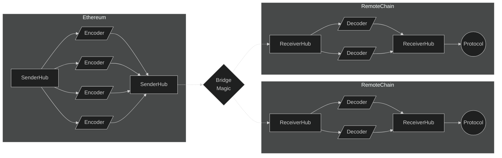

# Modular Multichain Governance

> NOTICE: The codebase is currently **not-audited** and is not ready for production usage.

Modular Multichain Governance is a system to pass messages from Ethereum L1 to L2's and other L1's
based on Uniswap governance decisions.

We define a `SenderHub` on Ethereum and a `ReceiverHub` on remote chains (L2's or other L1's), which are used to
abstract underlying bridge details for sending messages. The bridge details are abstracted by `Encoder` and `Decoder`
modules.

## Sending Messages

The `SenderHub` assigns an `Encoder` module for a given remote chain (by its `chainId`). When the `SenderHub` is called
by governance, it receives a list of multichain actions's. Each multichain action is a list of calls and a target chain
Id. For each multichain action, the `SenderHub` dispatches the respective `Encoder` for that chain, then the `Encoder`
returns to the `SenderHub` an address, call value, and encoded calldata such that the `SenderHub` can initiate the
bridge call. This ensures the `SenderHub` is always the caller on L1.

## Receiving Messages

The `ReceiverHub` assigns a `Decoder` module for a given calldata payload (by its selector). When the `ReceiverHub` is
called, it dispatches the encoded data to the respective `Decoder`, then the `Decoder` validates the data, decodes it,
and returns the originally sent list of calls for `ReceiverHub` to run. This ensures the `ReceiverHub` is always the
caller on the remote chain.



## Testing

Tests are split by kind under `test/`:

| Directory           | Contents                                                                 |
| ------------------- | ------------------------------------------------------------------------ |
| `test/unit/`        | One file per contract, every function and branch against mocks.          |
| `test/fuzz/`        | One file per contract, stateless fuzz tests against mocks.               |
| `test/integration/` | One file per bridge module, fork tests against the deployed bridge.      |
| `test/mocks/`       | Stand-ins for bridges, modules, and call targets.                        |
| `test/utils/`       | Shared helpers and interfaces of deployed contracts used by fork tests.  |

Unit and fuzz tests keep their steps inline. Logic that several tests need and that is not itself
under test (for example, relaying a bridge message from one fork to another) lives in `test/utils/`.

### Integration tests

Integration tests send actions from a `SenderHub` on an Ethereum fork through the real bridge, then
relay the message to a `ReceiverHub` on a fork of the remote chain. Forks are pinned to block
numbers, so the RPC endpoints need archive access:

```sh
export MAINNET_RPC_URL=...
export OPTIMISM_RPC_URL=...
export BASE_RPC_URL=...
export UNICHAIN_RPC_URL=...
export ARBITRUM_RPC_URL=...
export POLYGON_RPC_URL=...
export BNB_RPC_URL=...
export AVALANCHE_RPC_URL=...

forge test
```

To run without RPC access, skip them:

```sh
forge test --no-match-path "test/integration/*"
```
